Absenteeism at Work — Analysis
================
Brenda
2026-11-25

- [Introduction](#introduction)
- [Data ingestion](#data-ingestion)
- [Data preparation: recode categories as
  factors](#data-preparation-recode-categories-as-factors)
- [Data understanding (EDA)](#data-understanding-eda)
  - [Overview summaries](#overview-summaries)
  - [Data-quality checks](#data-quality-checks)
  - [Cleaning](#cleaning)
- [Exploring the target: absence
  hours](#exploring-the-target-absence-hours)
- [What drives absence duration?](#what-drives-absence-duration)
  - [By reason for absence](#by-reason-for-absence)
  - [Do the numeric variables relate to
    duration?](#do-the-numeric-variables-relate-to-duration)
  - [Do the other categories relate to
    duration?](#do-the-other-categories-relate-to-duration)
- [Absence frequency: a different
  question](#absence-frequency-a-different-question)
- [Clustering 1 — kinds of absences
  (absence-level)](#clustering-1--kinds-of-absences-absence-level)
  - [Choosing k (silhouette)](#choosing-k-silhouette)
  - [Fit and profile (k = 2)](#fit-and-profile-k--2)
  - [Sanity check — do clusters map to
    employees?](#sanity-check--do-clusters-map-to-employees)
- [Clustering 2 — kinds of employees
  (employee-level)](#clustering-2--kinds-of-employees-employee-level)
  - [Fit and profile (k = 3)](#fit-and-profile-k--3)
- [Save outputs for Power BI](#save-outputs-for-power-bi)
- [Findings summary](#findings-summary)

# Introduction

This analysis explores the UCI **Absenteeism at Work** dataset (740
absence records from 36 employees at a Brazilian courier company). It
follows the CRISP-DM process: understand the data, explore it, then
cluster it to answer two questions — *what kinds of absences happen
here?* and *what kinds of employees do we have?*

The main finding, previewed up front: absence **duration** is driven
mostly by the medical reason, while what separates employees is absence
**frequency** — and higher frequency is strongly associated with social
drinking.

``` r
library(tidyverse)   # data wrangling + ggplot2
library(janitor)     # clean_names()
library(skimr)       # skim() summaries
library(corrplot)    # correlation heatmap
library(cluster)     # daisy() (Gower distance) + pam()
```

# Data ingestion

The file is **semicolon-delimited**, so we read it with
`read_delim(delim = ";")`. `clean_names()` then tidies the messy column
names (trailing spaces, slashes) into snake_case.

``` r
# The path is relative to this R/ folder (knitting runs from here)
raw <- read_delim(
  "../data/Absenteeism_at_work.csv",
  delim = ";",
  show_col_types = FALSE
)

abs <- clean_names(raw)
glimpse(abs)
```

    ## Rows: 740
    ## Columns: 21
    ## $ id                              <dbl> 11, 36, 3, 7, 11, 3, 10, 20, 14, 1, 20, 20, 20, 3, 3, 24, 3, 3, 6, 33, 18, 3, 10, 20, 11, 10, 11, 30, 11, 3, 3, 2, 1, 2, 3, 10, 11, 19…
    ## $ reason_for_absence              <dbl> 26, 0, 23, 7, 23, 23, 22, 23, 19, 22, 1, 1, 11, 11, 23, 14, 23, 21, 11, 23, 10, 11, 13, 28, 18, 25, 23, 28, 18, 23, 18, 18, 23, 18, 23…
    ## $ month_of_absence                <dbl> 7, 7, 7, 7, 7, 7, 7, 7, 7, 7, 7, 7, 7, 7, 7, 7, 7, 7, 7, 8, 8, 8, 8, 8, 8, 8, 8, 8, 8, 8, 8, 8, 8, 8, 8, 8, 8, 8, 8, 8, 9, 9, 9, 9, 9,…
    ## $ day_of_the_week                 <dbl> 3, 3, 4, 5, 5, 6, 6, 6, 2, 2, 2, 3, 4, 4, 4, 6, 6, 2, 5, 4, 4, 2, 2, 6, 2, 2, 3, 4, 4, 6, 2, 5, 5, 2, 2, 2, 3, 5, 6, 6, 3, 2, 3, 3, 4,…
    ## $ seasons                         <dbl> 1, 1, 1, 1, 1, 1, 1, 1, 1, 1, 1, 1, 1, 1, 1, 1, 1, 1, 1, 1, 1, 1, 1, 1, 1, 1, 1, 1, 1, 1, 1, 1, 1, 1, 1, 1, 1, 1, 1, 1, 1, 1, 1, 1, 1,…
    ## $ transportation_expense          <dbl> 289, 118, 179, 279, 289, 179, 361, 260, 155, 235, 260, 260, 260, 179, 179, 246, 179, 179, 189, 248, 330, 179, 361, 260, 289, 361, 289,…
    ## $ distance_from_residence_to_work <dbl> 36, 13, 51, 5, 36, 51, 52, 50, 12, 11, 50, 50, 50, 51, 51, 25, 51, 51, 29, 25, 16, 51, 52, 50, 36, 52, 36, 27, 36, 51, 51, 29, 11, 29,…
    ## $ service_time                    <dbl> 13, 18, 18, 14, 13, 18, 3, 11, 14, 14, 11, 11, 11, 18, 18, 16, 18, 18, 13, 14, 4, 18, 3, 11, 13, 3, 13, 6, 13, 18, 18, 12, 14, 12, 18,…
    ## $ age                             <dbl> 33, 50, 38, 39, 33, 38, 28, 36, 34, 37, 36, 36, 36, 38, 38, 41, 38, 38, 33, 47, 28, 38, 28, 36, 33, 28, 33, 29, 33, 38, 38, 48, 37, 48…
    ## $ work_load_average_day           <dbl> 239.554, 239.554, 239.554, 239.554, 239.554, 239.554, 239.554, 239.554, 239.554, 239.554, 239.554, 239.554, 239.554, 239.554, 239.554,…
    ## $ hit_target                      <dbl> 97, 97, 97, 97, 97, 97, 97, 97, 97, 97, 97, 97, 97, 97, 97, 97, 97, 97, 97, 92, 92, 92, 92, 92, 92, 92, 92, 92, 92, 92, 92, 92, 92, 92…
    ## $ disciplinary_failure            <dbl> 0, 1, 0, 0, 0, 0, 0, 0, 0, 0, 0, 0, 0, 0, 0, 0, 0, 0, 0, 0, 0, 0, 0, 0, 0, 0, 0, 0, 0, 0, 0, 0, 0, 0, 0, 0, 0, 0, 0, 0, 0, 0, 0, 0, 0,…
    ## $ education                       <dbl> 1, 1, 1, 1, 1, 1, 1, 1, 1, 3, 1, 1, 1, 1, 1, 1, 1, 1, 1, 1, 2, 1, 1, 1, 1, 1, 1, 1, 1, 1, 1, 1, 3, 1, 1, 1, 1, 1, 1, 1, 1, 1, 1, 1, 1,…
    ## $ son                             <dbl> 2, 1, 0, 2, 2, 0, 1, 4, 2, 1, 4, 4, 4, 0, 0, 0, 0, 0, 2, 2, 0, 0, 1, 4, 2, 1, 2, 0, 2, 0, 0, 1, 1, 1, 0, 1, 2, 0, 1, 4, 0, 0, 0, 1, 2,…
    ## $ social_drinker                  <dbl> 1, 1, 1, 1, 1, 1, 1, 1, 1, 0, 1, 1, 1, 1, 1, 1, 1, 1, 0, 0, 0, 1, 1, 1, 1, 1, 1, 1, 1, 1, 1, 0, 0, 0, 1, 1, 1, 1, 0, 1, 0, 0, 1, 1, 1,…
    ## $ social_smoker                   <dbl> 0, 0, 0, 1, 0, 0, 0, 0, 0, 0, 0, 0, 0, 0, 0, 0, 0, 0, 0, 0, 0, 0, 0, 0, 0, 0, 0, 1, 0, 0, 0, 1, 0, 1, 0, 0, 0, 0, 1, 0, 0, 0, 0, 0, 0,…
    ## $ pet                             <dbl> 1, 0, 0, 0, 1, 0, 4, 0, 0, 1, 0, 0, 0, 0, 0, 0, 0, 0, 2, 1, 0, 0, 4, 0, 1, 4, 1, 0, 1, 0, 0, 5, 1, 5, 0, 4, 1, 0, 5, 0, 0, 0, 0, 0, 0,…
    ## $ weight                          <dbl> 90, 98, 89, 68, 90, 89, 80, 65, 95, 88, 65, 65, 65, 89, 89, 67, 89, 89, 69, 86, 84, 89, 80, 65, 90, 80, 90, 75, 90, 89, 89, 88, 88, 88…
    ## $ height                          <dbl> 172, 178, 170, 168, 172, 170, 172, 168, 196, 172, 168, 168, 168, 170, 170, 170, 170, 170, 167, 165, 182, 170, 172, 168, 172, 172, 172,…
    ## $ body_mass_index                 <dbl> 30, 31, 31, 24, 30, 31, 27, 23, 25, 29, 23, 23, 23, 31, 31, 23, 31, 31, 25, 32, 25, 31, 27, 23, 30, 27, 30, 22, 30, 31, 31, 33, 29, 33…
    ## $ absenteeism_time_in_hours       <dbl> 4, 0, 2, 4, 2, 2, 8, 4, 40, 8, 8, 8, 8, 1, 4, 8, 2, 8, 8, 2, 8, 1, 40, 4, 8, 7, 1, 4, 8, 2, 8, 8, 4, 8, 2, 1, 8, 4, 8, 4, 2, 4, 4, 8, …

**Output:** 740 rows, 21 columns. Note every column reads as numeric
(`<dbl>`), even though many are really categories in disguise (reason
codes, day of week, yes/no flags). We fix that next.

# Data preparation: recode categories as factors

Many columns are *labels stored as numbers* — e.g. `day_of_the_week`
uses codes 2–6 for Mon–Fri. Treating them as numbers would let R do
nonsense arithmetic (“Thursday minus Monday = 3”). Converting them to
**factors** tells R they are categories, not quantities.

``` r
abs <- abs %>%
  mutate(
    id = factor(id),   # an employee label, never a quantity

    day_of_the_week = factor(day_of_the_week,
                             levels = c(2, 3, 4, 5, 6),
                             labels = c("Mon", "Tue", "Wed", "Thu", "Fri")),

    seasons = factor(seasons,
                     levels = c(1, 2, 3, 4),
                     labels = c("Summer", "Autumn", "Winter", "Spring")),

    education = factor(education,
                       levels = c(1, 2, 3, 4),
                       labels = c("High school", "Graduate",
                                  "Postgraduate", "Master/Doctor")),

    # Binary flags: 0/1 -> No/Yes
    disciplinary_failure = factor(disciplinary_failure, levels = c(0, 1), labels = c("No", "Yes")),
    social_drinker       = factor(social_drinker,       levels = c(0, 1), labels = c("No", "Yes")),
    social_smoker        = factor(social_smoker,        levels = c(0, 1), labels = c("No", "Yes")),

    # Kept as plain factor codes (no custom labels)
    reason_for_absence = factor(reason_for_absence),
    month_of_absence   = factor(month_of_absence)
  )

glimpse(abs)
```

    ## Rows: 740
    ## Columns: 21
    ## $ id                              <fct> 11, 36, 3, 7, 11, 3, 10, 20, 14, 1, 20, 20, 20, 3, 3, 24, 3, 3, 6, 33, 18, 3, 10, 20, 11, 10, 11, 30, 11, 3, 3, 2, 1, 2, 3, 10, 11, 19…
    ## $ reason_for_absence              <fct> 26, 0, 23, 7, 23, 23, 22, 23, 19, 22, 1, 1, 11, 11, 23, 14, 23, 21, 11, 23, 10, 11, 13, 28, 18, 25, 23, 28, 18, 23, 18, 18, 23, 18, 23…
    ## $ month_of_absence                <fct> 7, 7, 7, 7, 7, 7, 7, 7, 7, 7, 7, 7, 7, 7, 7, 7, 7, 7, 7, 8, 8, 8, 8, 8, 8, 8, 8, 8, 8, 8, 8, 8, 8, 8, 8, 8, 8, 8, 8, 8, 9, 9, 9, 9, 9,…
    ## $ day_of_the_week                 <fct> Tue, Tue, Wed, Thu, Thu, Fri, Fri, Fri, Mon, Mon, Mon, Tue, Wed, Wed, Wed, Fri, Fri, Mon, Thu, Wed, Wed, Mon, Mon, Fri, Mon, Mon, Tue,…
    ## $ seasons                         <fct> Summer, Summer, Summer, Summer, Summer, Summer, Summer, Summer, Summer, Summer, Summer, Summer, Summer, Summer, Summer, Summer, Summer…
    ## $ transportation_expense          <dbl> 289, 118, 179, 279, 289, 179, 361, 260, 155, 235, 260, 260, 260, 179, 179, 246, 179, 179, 189, 248, 330, 179, 361, 260, 289, 361, 289,…
    ## $ distance_from_residence_to_work <dbl> 36, 13, 51, 5, 36, 51, 52, 50, 12, 11, 50, 50, 50, 51, 51, 25, 51, 51, 29, 25, 16, 51, 52, 50, 36, 52, 36, 27, 36, 51, 51, 29, 11, 29,…
    ## $ service_time                    <dbl> 13, 18, 18, 14, 13, 18, 3, 11, 14, 14, 11, 11, 11, 18, 18, 16, 18, 18, 13, 14, 4, 18, 3, 11, 13, 3, 13, 6, 13, 18, 18, 12, 14, 12, 18,…
    ## $ age                             <dbl> 33, 50, 38, 39, 33, 38, 28, 36, 34, 37, 36, 36, 36, 38, 38, 41, 38, 38, 33, 47, 28, 38, 28, 36, 33, 28, 33, 29, 33, 38, 38, 48, 37, 48…
    ## $ work_load_average_day           <dbl> 239.554, 239.554, 239.554, 239.554, 239.554, 239.554, 239.554, 239.554, 239.554, 239.554, 239.554, 239.554, 239.554, 239.554, 239.554,…
    ## $ hit_target                      <dbl> 97, 97, 97, 97, 97, 97, 97, 97, 97, 97, 97, 97, 97, 97, 97, 97, 97, 97, 97, 92, 92, 92, 92, 92, 92, 92, 92, 92, 92, 92, 92, 92, 92, 92…
    ## $ disciplinary_failure            <fct> No, Yes, No, No, No, No, No, No, No, No, No, No, No, No, No, No, No, No, No, No, No, No, No, No, No, No, No, No, No, No, No, No, No, N…
    ## $ education                       <fct> High school, High school, High school, High school, High school, High school, High school, High school, High school, Postgraduate, Hig…
    ## $ son                             <dbl> 2, 1, 0, 2, 2, 0, 1, 4, 2, 1, 4, 4, 4, 0, 0, 0, 0, 0, 2, 2, 0, 0, 1, 4, 2, 1, 2, 0, 2, 0, 0, 1, 1, 1, 0, 1, 2, 0, 1, 4, 0, 0, 0, 1, 2,…
    ## $ social_drinker                  <fct> Yes, Yes, Yes, Yes, Yes, Yes, Yes, Yes, Yes, No, Yes, Yes, Yes, Yes, Yes, Yes, Yes, Yes, No, No, No, Yes, Yes, Yes, Yes, Yes, Yes, Yes…
    ## $ social_smoker                   <fct> No, No, No, Yes, No, No, No, No, No, No, No, No, No, No, No, No, No, No, No, No, No, No, No, No, No, No, No, Yes, No, No, No, Yes, No,…
    ## $ pet                             <dbl> 1, 0, 0, 0, 1, 0, 4, 0, 0, 1, 0, 0, 0, 0, 0, 0, 0, 0, 2, 1, 0, 0, 4, 0, 1, 4, 1, 0, 1, 0, 0, 5, 1, 5, 0, 4, 1, 0, 5, 0, 0, 0, 0, 0, 0,…
    ## $ weight                          <dbl> 90, 98, 89, 68, 90, 89, 80, 65, 95, 88, 65, 65, 65, 89, 89, 67, 89, 89, 69, 86, 84, 89, 80, 65, 90, 80, 90, 75, 90, 89, 89, 88, 88, 88…
    ## $ height                          <dbl> 172, 178, 170, 168, 172, 170, 172, 168, 196, 172, 168, 168, 168, 170, 170, 170, 170, 170, 167, 165, 182, 170, 172, 168, 172, 172, 172,…
    ## $ body_mass_index                 <dbl> 30, 31, 31, 24, 30, 31, 27, 23, 25, 29, 23, 23, 23, 31, 31, 23, 31, 31, 25, 32, 25, 31, 27, 23, 30, 27, 30, 22, 30, 31, 31, 33, 29, 33…
    ## $ absenteeism_time_in_hours       <dbl> 4, 0, 2, 4, 2, 2, 8, 4, 40, 8, 8, 8, 8, 1, 4, 8, 2, 8, 8, 2, 8, 1, 40, 4, 8, 7, 1, 4, 8, 2, 8, 8, 4, 8, 2, 1, 8, 4, 8, 4, 2, 4, 4, 8, …

Quick check that the recoding took — the factor levels and a tally of
one:

``` r
levels(abs$day_of_the_week)   # allowed categories, in order
```

    ## [1] "Mon" "Tue" "Wed" "Thu" "Fri"

``` r
table(abs$day_of_the_week)    # count of absences per weekday
```

    ## 
    ## Mon Tue Wed Thu Fri 
    ## 161 154 156 125 144

# Data understanding (EDA)

## Overview summaries

`summary()` and `skim()` give a first look at every column —
type-appropriate stats for numbers, category counts for factors.

``` r
summary(abs)
```

    ##        id      reason_for_absence month_of_absence day_of_the_week   seasons    transportation_expense distance_from_residence_to_work  service_time        age       
    ##  3      :113   23     :149        3      : 87      Mon:161         Summer:170   Min.   :118.0          Min.   : 5.00                   Min.   : 1.00   Min.   :27.00  
    ##  28     : 76   28     :112        2      : 72      Tue:154         Autumn:192   1st Qu.:179.0          1st Qu.:16.00                   1st Qu.: 9.00   1st Qu.:31.00  
    ##  34     : 55   27     : 69        10     : 71      Wed:156         Winter:183   Median :225.0          Median :26.00                   Median :13.00   Median :37.00  
    ##  22     : 46   13     : 55        7      : 67      Thu:125         Spring:195   Mean   :221.3          Mean   :29.63                   Mean   :12.55   Mean   :36.45  
    ##  20     : 42   0      : 43        5      : 64      Fri:144                      3rd Qu.:260.0          3rd Qu.:50.00                   3rd Qu.:16.00   3rd Qu.:40.00  
    ##  11     : 40   19     : 40        11     : 63                                   Max.   :388.0          Max.   :52.00                   Max.   :29.00   Max.   :58.00  
    ##  (Other):368   (Other):272        (Other):316                                                                                                                         
    ##  work_load_average_day   hit_target     disciplinary_failure         education        son        social_drinker social_smoker      pet             weight           height     
    ##  Min.   :205.9         Min.   : 81.00   No :700              High school  :611   Min.   :0.000   No :320        No :686       Min.   :0.0000   Min.   : 56.00   Min.   :163.0  
    ##  1st Qu.:244.4         1st Qu.: 93.00   Yes: 40              Graduate     : 46   1st Qu.:0.000   Yes:420        Yes: 54       1st Qu.:0.0000   1st Qu.: 69.00   1st Qu.:169.0  
    ##  Median :264.2         Median : 95.00                        Postgraduate : 79   Median :1.000                                Median :0.0000   Median : 83.00   Median :170.0  
    ##  Mean   :271.5         Mean   : 94.59                        Master/Doctor:  4   Mean   :1.019                                Mean   :0.7459   Mean   : 79.04   Mean   :172.1  
    ##  3rd Qu.:294.2         3rd Qu.: 97.00                                            3rd Qu.:2.000                                3rd Qu.:1.0000   3rd Qu.: 89.00   3rd Qu.:172.0  
    ##  Max.   :378.9         Max.   :100.00                                            Max.   :4.000                                Max.   :8.0000   Max.   :108.00   Max.   :196.0  
    ##                                                                                                                                                                                
    ##  body_mass_index absenteeism_time_in_hours
    ##  Min.   :19.00   Min.   :  0.000          
    ##  1st Qu.:24.00   1st Qu.:  2.000          
    ##  Median :25.00   Median :  3.000          
    ##  Mean   :26.68   Mean   :  6.924          
    ##  3rd Qu.:31.00   3rd Qu.:  8.000          
    ##  Max.   :38.00   Max.   :120.000          
    ## 

``` r
skim(abs)
```

|                                                  |      |
|:-------------------------------------------------|:-----|
| Name                                             | abs  |
| Number of rows                                   | 740  |
| Number of columns                                | 21   |
| \_\_\_\_\_\_\_\_\_\_\_\_\_\_\_\_\_\_\_\_\_\_\_   |      |
| Column type frequency:                           |      |
| factor                                           | 9    |
| numeric                                          | 12   |
| \_\_\_\_\_\_\_\_\_\_\_\_\_\_\_\_\_\_\_\_\_\_\_\_ |      |
| Group variables                                  | None |

Data summary

**Variable type: factor**

| skim_variable | n_missing | complete_rate | ordered | n_unique | top_counts |
|:---|---:|---:|:---|---:|:---|
| id | 0 | 1 | FALSE | 36 | 3: 113, 28: 76, 34: 55, 22: 46 |
| reason_for_absence | 0 | 1 | FALSE | 28 | 23: 149, 28: 112, 27: 69, 13: 55 |
| month_of_absence | 0 | 1 | FALSE | 13 | 3: 87, 2: 72, 10: 71, 7: 67 |
| day_of_the_week | 0 | 1 | FALSE | 5 | Mon: 161, Wed: 156, Tue: 154, Fri: 144 |
| seasons | 0 | 1 | FALSE | 4 | Spr: 195, Aut: 192, Win: 183, Sum: 170 |
| disciplinary_failure | 0 | 1 | FALSE | 2 | No: 700, Yes: 40 |
| education | 0 | 1 | FALSE | 4 | Hig: 611, Pos: 79, Gra: 46, Mas: 4 |
| social_drinker | 0 | 1 | FALSE | 2 | Yes: 420, No: 320 |
| social_smoker | 0 | 1 | FALSE | 2 | No: 686, Yes: 54 |

**Variable type: numeric**

| skim_variable | n_missing | complete_rate | mean | sd | p0 | p25 | p50 | p75 | p100 | hist |
|:---|---:|---:|---:|---:|---:|---:|---:|---:|---:|:---|
| transportation_expense | 0 | 1 | 221.33 | 66.95 | 118.00 | 179.00 | 225.00 | 260.00 | 388.00 | ▃▇▅▃▂ |
| distance_from_residence_to_work | 0 | 1 | 29.63 | 14.84 | 5.00 | 16.00 | 26.00 | 50.00 | 52.00 | ▅▃▇▂▇ |
| service_time | 0 | 1 | 12.55 | 4.38 | 1.00 | 9.00 | 13.00 | 16.00 | 29.00 | ▂▇▆▃▁ |
| age | 0 | 1 | 36.45 | 6.48 | 27.00 | 31.00 | 37.00 | 40.00 | 58.00 | ▇▇▃▂▁ |
| work_load_average_day | 0 | 1 | 271.49 | 39.06 | 205.92 | 244.39 | 264.25 | 294.22 | 378.88 | ▅▇▃▂▁ |
| hit_target | 0 | 1 | 94.59 | 3.78 | 81.00 | 93.00 | 95.00 | 97.00 | 100.00 | ▁▁▃▇▇ |
| son | 0 | 1 | 1.02 | 1.10 | 0.00 | 0.00 | 1.00 | 2.00 | 4.00 | ▇▆▅▁▁ |
| pet | 0 | 1 | 0.75 | 1.32 | 0.00 | 0.00 | 0.00 | 1.00 | 8.00 | ▇▁▁▁▁ |
| weight | 0 | 1 | 79.04 | 12.88 | 56.00 | 69.00 | 83.00 | 89.00 | 108.00 | ▅▇▅▇▂ |
| height | 0 | 1 | 172.11 | 6.03 | 163.00 | 169.00 | 170.00 | 172.00 | 196.00 | ▃▇▂▁▁ |
| body_mass_index | 0 | 1 | 26.68 | 4.29 | 19.00 | 24.00 | 25.00 | 31.00 | 38.00 | ▃▇▅▅▁ |
| absenteeism_time_in_hours | 0 | 1 | 6.92 | 13.33 | 0.00 | 2.00 | 3.00 | 8.00 | 120.00 | ▇▁▁▁▁ |

## Data-quality checks

Two hidden issues to catch before analysis.

**Issue 1 — impossible months.** Month should be 1–12; a `0` bucket is a
data-entry error.

``` r
table(abs$month_of_absence)
```

    ## 
    ##  0  1  2  3  4  5  6  7  8  9 10 11 12 
    ##  3 50 72 87 53 64 54 67 54 53 71 63 49

**Issue 2 — zero-hour “absences”.** These turn out to be disciplinary
records (reason 0, disciplinary_failure = Yes), not real absences.

``` r
table(abs$absenteeism_time_in_hours == 0)
```

    ## 
    ## FALSE  TRUE 
    ##   696    44

``` r
abs %>%
  filter(absenteeism_time_in_hours == 0) %>%
  count(reason_for_absence, disciplinary_failure)
```

    ## # A tibble: 3 × 3
    ##   reason_for_absence disciplinary_failure     n
    ##   <fct>              <fct>                <int>
    ## 1 0                  No                       3
    ## 2 0                  Yes                     40
    ## 3 27                 No                       1

**Output:** 44 zero-hour rows, ~40 of them disciplinary. These aren’t
absences, so we drop them — a scope decision (analyse *genuine*
absences), not just a data-quality fix.

## Cleaning

``` r
abs_clean <- abs %>%
  filter(month_of_absence != 0) %>%        # drop 3 broken-month rows
  filter(absenteeism_time_in_hours > 0)    # keep only genuine absences (>0 hrs)

nrow(abs)         # 740 (original, untouched)
```

    ## [1] 740

``` r
nrow(abs_clean)   # 696 (the month-0 rows were a subset of the zero-hour rows)
```

    ## [1] 696

**Note:** we land on 696, not 693 — the 3 month-0 rows were *already*
zero-hour rows, so the two filters overlap completely. Bad records
cluster together.

# Exploring the target: absence hours

The target is heavily right-skewed (a few very long absences), so we
view it on a `log(1 + x)` scale to see the structure. `log1p` is used
(not `log`) because it is safe at zero.

``` r
ggplot(abs_clean, aes(x = log1p(absenteeism_time_in_hours))) +
  geom_histogram(bins = 20, fill = "darkorange", color = "white") +
  labs(title = "Absence hours on a log(1 + x) scale — the skew flattens out",
       x = "log(1 + absence hours)", y = "Number of records") +
  theme_minimal()
```

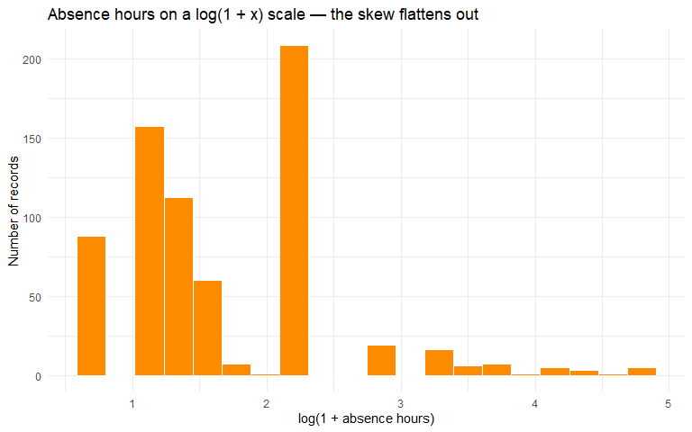

``` r
summary(abs_clean$absenteeism_time_in_hours)
```

    ##    Min. 1st Qu.  Median    Mean 3rd Qu.    Max. 
    ##   1.000   2.000   3.000   7.362   8.000 120.000

**Output:** median 3h, mean 7.4h. Mean far above median = strong right
skew. The tallest spike is at 8 hours — a full workday off.

# What drives absence duration?

## By reason for absence

``` r
ggplot(abs_clean, aes(x = reason_for_absence, y = absenteeism_time_in_hours)) +
  geom_boxplot(fill = "steelblue") +
  labs(title = "Absence duration varies a lot by reason",
       x = "Reason for absence (ICD code)", y = "Absence time (hours)") +
  theme_minimal()
```

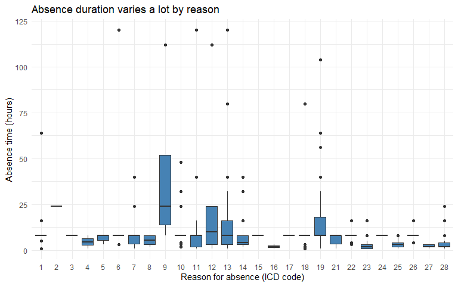

Reason clearly matters — but before trusting any single box, check how
many absences sit behind it (a dramatic box built on 4 rows is noise).

``` r
abs_clean %>%
  count(reason_for_absence, sort = TRUE) %>%
  print(n = 27)
```

    ## # A tibble: 27 × 2
    ##    reason_for_absence     n
    ##    <fct>              <int>
    ##  1 23                   149
    ##  2 28                   112
    ##  3 27                    68
    ##  4 13                    55
    ##  5 19                    40
    ##  6 22                    38
    ##  7 26                    33
    ##  8 25                    31
    ##  9 11                    26
    ## 10 10                    25
    ## 11 18                    21
    ## 12 14                    19
    ## 13 1                     16
    ## 14 7                     15
    ## 15 6                      8
    ## 16 12                     8
    ## 17 8                      6
    ## 18 21                     6
    ## 19 9                      4
    ## 20 5                      3
    ## 21 16                     3
    ## 22 24                     3
    ## 23 4                      2
    ## 24 15                     2
    ## 25 2                      1
    ## 26 3                      1
    ## 27 17                     1

**Output:** routine reasons dominate (23 medical consultation = 149, 28
dental = 112, 27 physiotherapy = 68), while several dramatic-looking
reasons have \< 5 absences. So we re-plot using only reasons with
**10+** absences, ordered by median duration:

``` r
common_reasons <- abs_clean %>%
  count(reason_for_absence) %>%
  filter(n >= 10) %>%
  pull(reason_for_absence)

abs_clean %>%
  filter(reason_for_absence %in% common_reasons) %>%
  ggplot(aes(x = reorder(reason_for_absence, absenteeism_time_in_hours, FUN = median),
             y = absenteeism_time_in_hours)) +
  geom_boxplot(fill = "steelblue") +
  coord_flip() +
  labs(title = "Absence duration by reason (reasons with 10+ absences)",
       subtitle = "Ordered by median; rare reasons excluded to avoid over-reading noise",
       x = "Reason for absence (ICD code)", y = "Absence time (hours)") +
  theme_minimal()
```

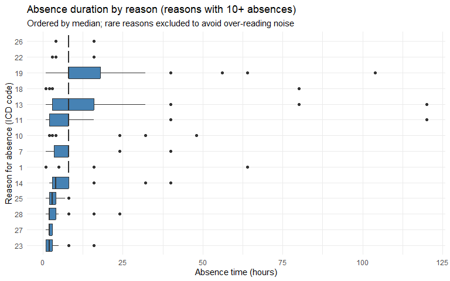

**Output:** routine care (dental, physiotherapy, consultation) → short;
injury and musculoskeletal → longer and more variable.

## Do the numeric variables relate to duration?

Correlation measures straight-line association between numbers. We
compute it between absence hours and every numeric suspect, then rank.

``` r
numeric_suspects <- abs_clean %>%
  select(absenteeism_time_in_hours, age, service_time, work_load_average_day,
         transportation_expense, distance_from_residence_to_work, hit_target,
         son, pet, weight, height, body_mass_index)

cor_matrix <- cor(numeric_suspects)

sort(cor_matrix[, "absenteeism_time_in_hours"], decreasing = TRUE)
```

    ##       absenteeism_time_in_hours                          height                             son                             age          transportation_expense 
    ##                     1.000000000                     0.147384743                     0.127682640                     0.086037842                     0.040808205 
    ##           work_load_average_day                          weight                    service_time                      hit_target                             pet 
    ##                     0.030206432                     0.028674046                     0.019654432                     0.009171166                    -0.022864153 
    ##                 body_mass_index distance_from_residence_to_work 
    ##                    -0.039468357                    -0.099886258

**Output:** every correlation is under 0.15 — essentially no linear
relationship. Duration is not driven by any single number (age,
distance, workload, BMI…). That’s a real finding: the signal lives in
the *categories*, not the numbers.

We double-check the least-weak one (`son`) as categories, in case a
curve was hiding that correlation missed:

``` r
abs_clean %>%
  ggplot(aes(x = factor(son), y = absenteeism_time_in_hours)) +
  geom_boxplot(fill = "steelblue") +
  labs(title = "Absence duration by number of children",
       x = "Number of children", y = "Absence time (hours)") +
  theme_minimal()
```

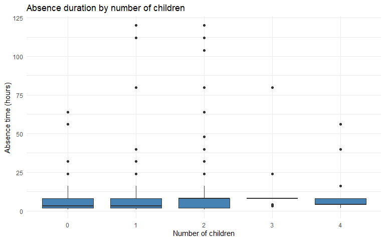

**Output:** flat across all groups — confirms no relationship.

## Do the other categories relate to duration?

We reshape to long format (`pivot_longer`) so we can facet all
categorical suspects into one consolidated plot.

``` r
abs_long <- abs_clean %>%
  select(absenteeism_time_in_hours, day_of_the_week, seasons,
         social_drinker, social_smoker, education) %>%
  pivot_longer(
    cols = c(day_of_the_week, seasons, social_drinker, social_smoker, education),
    names_to = "variable",
    values_to = "value"
  )

ggplot(abs_long, aes(x = value, y = absenteeism_time_in_hours)) +
  geom_boxplot(fill = "steelblue") +
  facet_wrap(~ variable, scales = "free_x") +
  labs(title = "Absence duration across the categorical suspects",
       x = NULL, y = "Absence time (hours)") +
  theme_minimal() +
  theme(axis.text.x = element_text(angle = 45, hjust = 1))
```

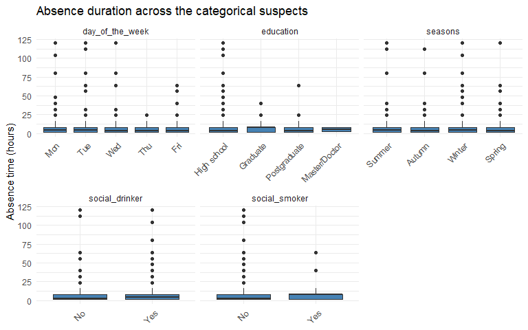

**Output:** all five panels are flat. Day, season, education, drinker,
smoker — none change absence *duration*. Combined with the flat
correlations, this cements it: **duration is driven by the medical
reason and little else.**

# Absence frequency: a different question

Duration plots are blind to *how often* someone is absent. So we
aggregate to one row per employee and look at frequency instead.

``` r
freq <- abs_clean %>%
  group_by(id) %>%
  summarise(n_absences = n(),
            total_hours = sum(absenteeism_time_in_hours),
            .groups = "drop")

arrange(freq, desc(n_absences))
```

    ## # A tibble: 33 × 3
    ##    id    n_absences total_hours
    ##    <fct>      <int>       <dbl>
    ##  1 3            112         482
    ##  2 28            75         347
    ##  3 34            54         344
    ##  4 22            46         253
    ##  5 20            39         306
    ##  6 11            38         450
    ##  7 15            35         253
    ##  8 14            29         476
    ##  9 24            29         254
    ## 10 36            28         311
    ## # ℹ 23 more rows

``` r
ggplot(freq, aes(x = n_absences)) +
  geom_histogram(binwidth = 5, fill = "steelblue", color = "white") +
  labs(title = "Absence frequency varies widely across employees",
       x = "Number of absences", y = "Employees") +
  theme_minimal()
```

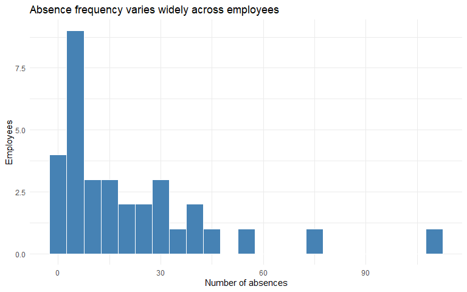

**Output:** very uneven — a few employees absent constantly, most
rarely.

Now attach fixed traits and test whether they relate to frequency.

``` r
freq2 <- abs_clean %>%
  group_by(id) %>%
  summarise(n_absences = n(),
            social_drinker = first(social_drinker),
            social_smoker  = first(social_smoker),
            age = first(age),
            .groups = "drop")

ggplot(freq2, aes(x = social_drinker, y = n_absences)) +
  geom_boxplot(fill = "steelblue") +
  labs(title = "Absence frequency by drinker status",
       x = "Social drinker", y = "Number of absences") +
  theme_minimal()
```

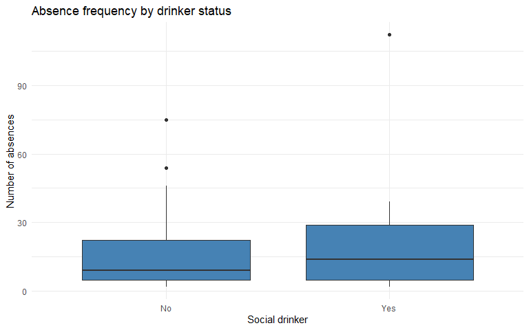

``` r
ggplot(freq2, aes(x = social_smoker, y = n_absences)) +
  geom_boxplot(fill = "steelblue") +
  labs(title = "Absence frequency by smoker status",
       x = "Social smoker", y = "Number of absences") +
  theme_minimal()
```

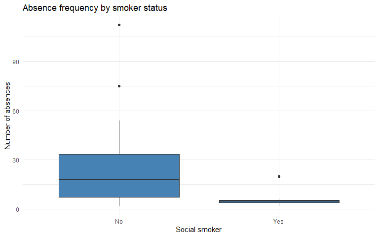

``` r
ggplot(freq2, aes(x = age, y = n_absences)) +
  geom_point(size = 3, color = "steelblue") +
  geom_smooth(method = "lm", se = FALSE, color = "darkorange") +
  labs(title = "Absence frequency vs age", x = "Age", y = "Number of absences") +
  theme_minimal()
```

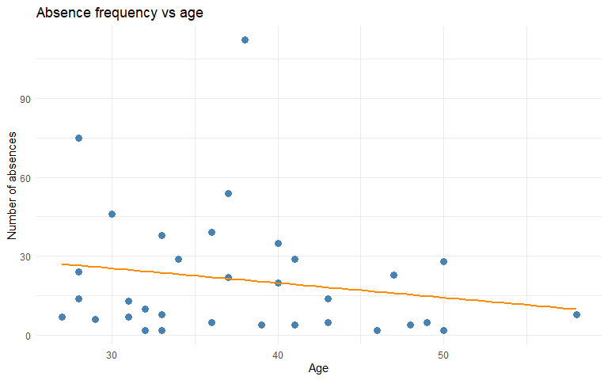

Always check group sizes before trusting a split:

``` r
freq2 %>% count(social_smoker)
```

    ## # A tibble: 2 × 2
    ##   social_smoker     n
    ##   <fct>         <int>
    ## 1 No               26
    ## 2 Yes               7

``` r
freq2 %>% count(social_drinker)
```

    ## # A tibble: 2 × 2
    ##   social_drinker     n
    ##   <fct>          <int>
    ## 1 No                16
    ## 2 Yes               17

**Output:** drinkers (16 No / 17 Yes) are balanced — the drinker split
is **credible**, and drinkers are absent more often. Smokers (only 7
Yes) are too few to trust. Age trend is weak and outlier-driven. So:
**drinking relates to higher frequency; that’s the one solid frequency
lead.**

# Clustering 1 — kinds of absences (absence-level)

We cluster the 696 absences. Because the data is **mixed** (numbers +
categories), k-means won’t work — it can only do arithmetic on numbers.
We use **Gower distance** (handles mixed types) fed into **PAM**
(k-means’s cousin that accepts a distance matrix).

``` r
clust_data <- abs_clean %>%
  select(reason_for_absence, month_of_absence, day_of_the_week, seasons,
         absenteeism_time_in_hours, transportation_expense,
         distance_from_residence_to_work, age,
         social_drinker, social_smoker, education)

str(clust_data)   # confirm factors are factors, numbers are numbers
```

    ## tibble [696 × 11] (S3: tbl_df/tbl/data.frame)
    ##  $ reason_for_absence             : Factor w/ 28 levels "0","1","2","3",..: 26 23 8 23 23 22 23 20 22 2 ...
    ##  $ month_of_absence               : Factor w/ 13 levels "0","1","2","3",..: 8 8 8 8 8 8 8 8 8 8 ...
    ##  $ day_of_the_week                : Factor w/ 5 levels "Mon","Tue","Wed",..: 2 3 4 4 5 5 5 1 1 1 ...
    ##  $ seasons                        : Factor w/ 4 levels "Summer","Autumn",..: 1 1 1 1 1 1 1 1 1 1 ...
    ##  $ absenteeism_time_in_hours      : num [1:696] 4 2 4 2 2 8 4 40 8 8 ...
    ##  $ transportation_expense         : num [1:696] 289 179 279 289 179 361 260 155 235 260 ...
    ##  $ distance_from_residence_to_work: num [1:696] 36 51 5 36 51 52 50 12 11 50 ...
    ##  $ age                            : num [1:696] 33 38 39 33 38 28 36 34 37 36 ...
    ##  $ social_drinker                 : Factor w/ 2 levels "No","Yes": 2 2 2 2 2 2 2 2 1 2 ...
    ##  $ social_smoker                  : Factor w/ 2 levels "No","Yes": 1 1 2 1 1 1 1 1 1 1 ...
    ##  $ education                      : Factor w/ 4 levels "High school",..: 1 1 1 1 1 1 1 1 3 1 ...

``` r
gower_dist <- daisy(clust_data, metric = "gower")
summary(gower_dist)   # Gower distances fall between 0 and 1
```

    ## 241860 dissimilarities, summarized :
    ##    Min. 1st Qu.  Median    Mean 3rd Qu.    Max. 
    ##  0.0000  0.3976  0.4759  0.4738  0.5546  0.8293 
    ## Metric :  mixed ;  Types = N, N, N, N, I, I, I, I, N, N, N 
    ## Number of objects : 696

## Choosing k (silhouette)

Try k = 2–8; higher silhouette width = better-separated clusters.

``` r
sil_width <- numeric(8)
for (k in 2:8) {
  pam_fit <- pam(gower_dist, diss = TRUE, k = k)
  sil_width[k] <- pam_fit$silinfo$avg.width
}

plot(2:8, sil_width[2:8], type = "b",
     xlab = "Number of clusters (k)", ylab = "Average silhouette width",
     main = "Higher = better-separated clusters")
```

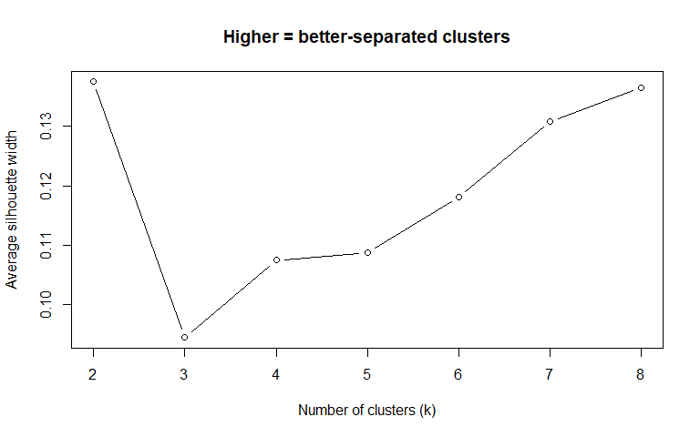

**Output:** all scores are low (~0.14) — absences do **not** form crisp
types. We take k = 2 (interpretable) and report the weak separation
honestly.

## Fit and profile (k = 2)

``` r
pam_fit <- pam(gower_dist, diss = TRUE, k = 2)

abs_clustered <- clust_data %>%
  mutate(cluster = as.factor(pam_fit$clustering))

table(abs_clustered$cluster)   # ~351 / 345, an even split
```

    ## 
    ##   1   2 
    ## 351 345

``` r
abs_clustered %>%
  group_by(cluster) %>%
  summarise(n = n(),
            avg_hours    = mean(absenteeism_time_in_hours),
            avg_age      = mean(age),
            avg_distance = mean(distance_from_residence_to_work),
            avg_expense  = mean(transportation_expense))
```

    ## # A tibble: 2 × 6
    ##   cluster     n avg_hours avg_age avg_distance avg_expense
    ##   <fct>   <int>     <dbl>   <dbl>        <dbl>       <dbl>
    ## 1 1         351      6.03    35.3         22.7        217.
    ## 2 2         345      8.71    37.2         37.1        223.

What defines the split — drinker and education (as proportions):

``` r
abs_clustered %>%
  count(cluster, social_drinker) %>%
  group_by(cluster) %>%
  mutate(proportion = n / sum(n))
```

    ## # A tibble: 4 × 4
    ## # Groups:   cluster [2]
    ##   cluster social_drinker     n proportion
    ##   <fct>   <fct>          <int>      <dbl>
    ## 1 1       No               273     0.778 
    ## 2 1       Yes               78     0.222 
    ## 3 2       No                32     0.0928
    ## 4 2       Yes              313     0.907

``` r
abs_clustered %>%
  count(cluster, education) %>%
  group_by(cluster) %>%
  mutate(proportion = n / sum(n))
```

    ## # A tibble: 7 × 4
    ## # Groups:   cluster [2]
    ##   cluster education         n proportion
    ##   <fct>   <fct>         <int>      <dbl>
    ## 1 1       High school     251     0.715 
    ## 2 1       Graduate         34     0.0969
    ## 3 1       Postgraduate     66     0.188 
    ## 4 2       High school     320     0.928 
    ## 5 2       Graduate          9     0.0261
    ## 6 2       Postgraduate     12     0.0348
    ## 7 2       Master/Doctor     4     0.0116

**Output:** the two clusters split almost entirely on **drinker status**
(cluster 1 ≈ 78% non-drinkers, cluster 2 ≈ 91% drinkers), with education
and distance tracking along. These traits travel together.

## Sanity check — do clusters map to employees?

Since 696 absences come from 33 people, the split may really be a
*people* split.

``` r
check <- abs_clean %>%
  mutate(cluster = as.factor(pam_fit$clustering))

check %>%
  group_by(id) %>%
  summarise(n_absences = n(),
            pct_cluster1 = mean(cluster == 1),   # 1 = all in cluster 1, 0 = all in cluster 2
            .groups = "drop") %>%
  arrange(desc(n_absences))
```

    ## # A tibble: 33 × 3
    ##    id    n_absences pct_cluster1
    ##    <fct>      <int>        <dbl>
    ##  1 3            112       0.0268
    ##  2 28            75       0.96  
    ##  3 34            54       0.889 
    ##  4 22            46       0.826 
    ##  5 20            39       0.0513
    ##  6 11            38       0.395 
    ##  7 15            35       0.4   
    ##  8 14            29       0.241 
    ##  9 24            29       0.172 
    ## 10 36            28       0.429 
    ## # ℹ 23 more rows

**Output:** mostly (not purely) about people — the highest-volume
employees sit almost entirely in one cluster, but a few employees split
across both. So the clusters are largely an employee split, with some
genuine absence-level variation.

# Clustering 2 — kinds of employees (employee-level)

Absence-level clustering is blind to *frequency*. Aggregating to 33
employees lets us cluster on frequency + severity, which surfaces a
segmentation the absence-level model couldn’t.

``` r
emp_data <- abs_clean %>%
  group_by(id) %>%
  summarise(
    n_absences  = n(),                              # FREQUENCY
    avg_hours   = mean(absenteeism_time_in_hours),  # SEVERITY
    total_hours = sum(absenteeism_time_in_hours),   # total burden
    age         = first(age),
    distance    = first(distance_from_residence_to_work),
    drinker     = first(social_drinker),
    smoker      = first(social_smoker),
    education   = first(education),
    .groups = "drop"
  )

emp_data
```

    ## # A tibble: 33 × 9
    ##    id    n_absences avg_hours total_hours   age distance drinker smoker education   
    ##    <fct>      <int>     <dbl>       <dbl> <dbl>    <dbl> <fct>   <fct>  <fct>       
    ##  1 1             22      5.5          121    37       11 No      No     Postgraduate
    ##  2 2              4      6.25          25    48       29 No      Yes    High school 
    ##  3 3            112      4.30         482    38       51 Yes     No     High school 
    ##  4 5             14      7.43         104    43       20 Yes     No     High school 
    ##  5 6              8      9             72    33       29 No      No     High school 
    ##  6 7              4      7.5           30    39        5 Yes     Yes    High school 
    ##  7 9              8     32.8          262    58       14 No      No     High school 
    ##  8 10            24      7.75         186    28       52 Yes     No     High school 
    ##  9 11            38     11.8          450    33       36 Yes     No     High school 
    ## 10 12             7      4.86          34    31       51 Yes     No     Graduate    
    ## # ℹ 23 more rows

``` r
emp_features <- emp_data %>% select(-id)   # drop id for the distance calc
gower_emp <- daisy(emp_features, metric = "gower")

sil_emp <- numeric(8)
for (k in 2:8) {
  pam_k <- pam(gower_emp, diss = TRUE, k = k)
  sil_emp[k] <- pam_k$silinfo$avg.width
}
plot(2:8, sil_emp[2:8], type = "b",
     xlab = "k", ylab = "Avg silhouette width",
     main = "Employee clustering: how many segments?")
```

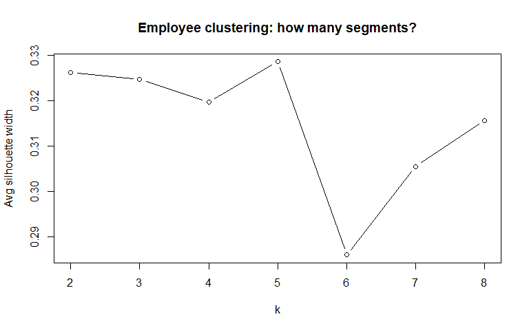

**Output:** silhouette ~0.33 — **much** cleaner than the absence-level
0.14. Fewer, cleaner rows separate better than many noisy ones. We
choose k = 3 (near the peak, and interpretable).

## Fit and profile (k = 3)

``` r
pam_emp <- pam(gower_emp, diss = TRUE, k = 3)

emp_data <- emp_data %>%
  mutate(segment = as.factor(pam_emp$clustering))

emp_data %>%
  group_by(segment) %>%
  summarise(
    n_employees    = n(),
    avg_n_absences = mean(n_absences),   # frequency
    avg_hours_each = mean(avg_hours),    # severity
    avg_total_hrs  = mean(total_hours),  # total burden
    avg_age        = mean(age),
    avg_distance   = mean(distance)
  )
```

    ## # A tibble: 3 × 7
    ##   segment n_employees avg_n_absences avg_hours_each avg_total_hrs avg_age avg_distance
    ##   <fct>         <int>          <dbl>          <dbl>         <dbl>   <dbl>        <dbl>
    ## 1 1                15           20.1           7.79          125.    37.7         24  
    ## 2 2                 5            4.2           8.70           37     41           20.4
    ## 3 3                13           28.8           8.45          236.    36.8         32.5

``` r
emp_data %>%
  group_by(segment) %>%
  summarise(n = n(),
            pct_drinker  = mean(drinker == "Yes"),
            pct_smoker   = mean(smoker == "Yes"),
            avg_distance = mean(distance))
```

    ## # A tibble: 3 × 5
    ##   segment     n pct_drinker pct_smoker avg_distance
    ##   <fct>   <int>       <dbl>      <dbl>        <dbl>
    ## 1 1          15         0        0.133         24  
    ## 2 2           5         0.8      1             20.4
    ## 3 3          13         1        0             32.5

**Output:** three segments form a **frequency ladder** — low (~4
absences), moderate (~20), high (~29) — while typical absence length
stays ~8h across all three. So employees differ by *how often*, not *how
long*. And the traits track perfectly: the high-frequency segment is
100% drinkers, the moderate segment 0%. The drinker signal appears a
third time (after the frequency boxplots and the absence-level
clustering) — strong corroboration in a 33-person sample.

``` r
abs_clustered <- abs_clean %>%
  mutate(
    cluster = as.factor(pam_fit$clustering),
    cluster_name = case_when(
      cluster == 1 ~ "Profile A",
      cluster == 2 ~ "Profile B"
    ))
```

``` r
emp_data <- emp_data %>%
  mutate(
    segment_name = case_when(
      segment == 1 ~ "Moderate",
      segment == 2 ~ "Low absence",
      segment == 3 ~ "High burden"
    ))
```

``` r
abs <- abs %>%
  mutate(
    reason_label = case_when(
      reason_for_absence == 23 ~ "Medical consultation",
      reason_for_absence == 28 ~ "Dental consultation",
      reason_for_absence == 27 ~ "Physiotherapy",
      reason_for_absence == 13 ~ "Musculoskeletal",
      reason_for_absence == 19 ~ "Injury / poisoning",
      reason_for_absence == 22 ~ "Follow-up medical",
      reason_for_absence == 26 ~ "Unjustified absence",
      reason_for_absence == 25 ~ "Lab exam / referral",
      reason_for_absence == 11 ~ "Digestive system",
      reason_for_absence == 10 ~ "Respiratory system",
      TRUE ~ "Other"    # everything not listed above
    )
  )
```

# Save outputs for Power BI

``` r
dir.create("../output", showWarnings = FALSE)   # make the folder if it isn't there yet

write_csv(abs,            "../output/absenteeism_full_labelled.csv")   # 740 rows, all labelled — for the EDA page
write_csv(abs_clustered,  "../output/absenteeism_clustered.csv")       # now WITH id + cluster_name
write_csv(emp_data,       "../output/employee_segments.csv")           # now WITH segment_name
```

# Findings summary

- **Duration** is driven mainly by the **medical reason**; numeric
  variables and most categories are flat.
- **Frequency** is where employees differ — a small reliable group, a
  moderate group, and a high-burden group that drives most lost time.
- Higher frequency is **strongly associated with social drinking** (seen
  three independent ways). Association only — small, entangled sample;
  not causation.
- **Absence-level clusters** are weak (they don’t form crisp types);
  **employee-level segments** are much cleaner and more actionable.

*Caveat throughout: 740 absences come from just 33 employees, so
person-level findings rest on a small sample — clear tendencies, not
population law.*
