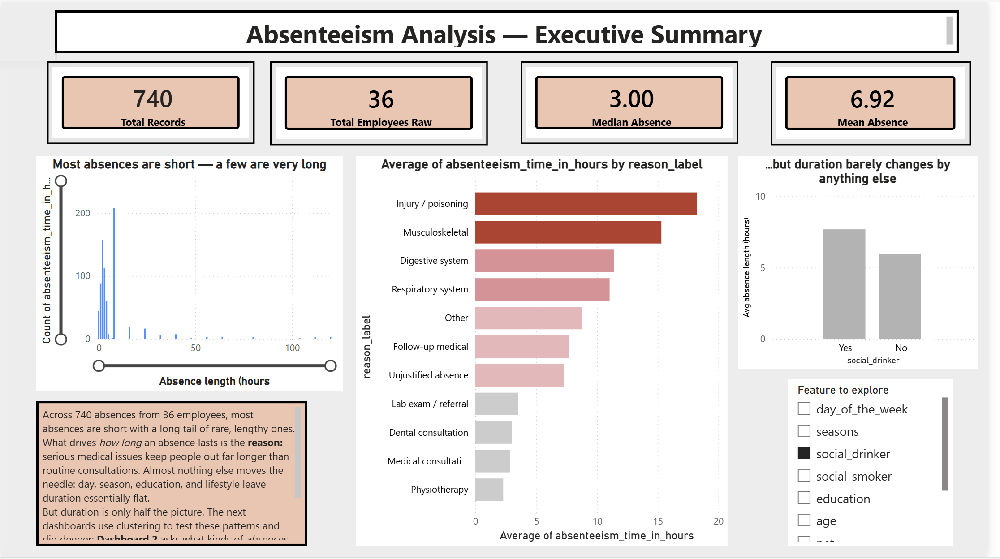
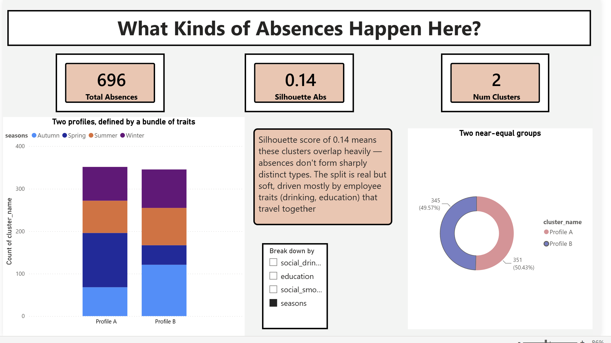
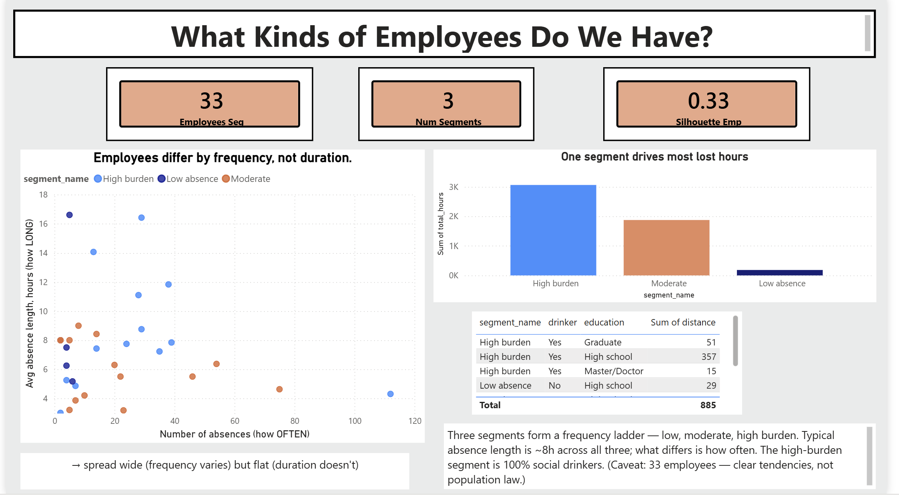

# Absenteeism at Work

**An R analysis of 740 workplace absence records from a Brazilian courier company. I look at what drives how long people are out, then cluster the data twice, once by absence and once by employee, and present the results in three Power BI dashboards.**

*Tools: R · tidyverse · janitor · skimr · cluster (Gower distance + PAM) · R Markdown · Power BI*



## The question

Absence data usually gets summarized as one number: hours lost. I wanted to pull that number apart. I asked three questions:

1. **What decides how long an absence lasts?** The medical reason, the person, or something about their job and commute?
2. **What kinds of absences happen here?** Do they fall into natural types?
3. **What kinds of employees are there?** Does absence look different when you count how *often* people are out instead of how *long*?

I followed CRISP-DM: data understanding, preparation, modelling, evaluation, then deployment as dashboards. Course project, MS in Data Analytics & Business, Seattle Pacific University, 2026.

## Data

- **Source:** [Absenteeism at Work](https://doi.org/10.24432/C5X882), UCI Machine Learning Repository (Martiniano & Ferreira, 2012). Licensed CC BY 4.0
- **Size:** 740 absence records from 36 employees. 21 columns: the reason for the absence (an ICD code), month, weekday, season, personal details (age, commute distance, education, children, pets, BMI, social drinker, social smoker) and the target, absence time in hours
- **Cleaning:** 44 records had zero hours. Most of them (40) were disciplinary records, not absences, so I dropped all 44. The 3 records with an impossible month of 0 were among them. That leaves **696 absences from 33 employees**
- **In this repo:** the raw CSV in `data/`, plus the cleaned and clustered tables the dashboards are built on in `output/`

## Methods

### 1. Preparation
The file is semicolon-delimited, and every column loads as a number, even the ones that are really categories (reason codes, weekdays, yes/no flags). I recoded those to factors so R treats them as labels, not quantities. Otherwise you get nonsense like "Thursday minus Monday = 3".

### 2. What drives duration
Absence hours are heavily right-skewed: a median of 3 hours, a mean of 7.4 and a maximum of 120. I compared duration against the reason for the absence, against every numeric variable (correlations), and against the categorical variables (boxplots). I only plotted reasons with 10 or more absences, so a dramatic box built on 3 records wouldn't drive the story.

### 3. Frequency per employee
Duration plots can't see how often someone is absent, so I also rolled the data up to one row per employee (number of absences, average hours, total hours) and compared drinkers against non-drinkers.

### 4. Clustering at two levels
The data mixes numbers and categories, which rules out k-means: it can only do arithmetic on numbers. I used **Gower distance**, which handles mixed types, with **PAM** (partitioning around medoids), which clusters from a distance matrix. I chose k by average silhouette width, trying k = 2 to 8.
- **Absence level:** all 696 absences, on reason, timing (month, weekday, season), hours, commute, age, and drinker, smoker and education status
- **Employee level:** 33 employees, on number of absences, average and total hours, age, commute distance, and drinker, smoker and education status

### 5. Dashboards
The R Markdown saves the labelled and clustered tables as CSVs, which feed three Power BI dashboards: the raw-data story, the absence clusters and the employee segments.

| | |
|---|---|
|  |  |
| **Absence clusters:** two near-equal profiles, with a silhouette of 0.14 shown on the page | **Employee segments:** absences per employee vs. average length, and lost hours by segment |

## Key result

> **How long an absence lasts depends on the medical reason and almost nothing else. Where employees differ is how often they're out, and the 13 social drinkers in the high-burden segment account for 60% of all lost hours.**

- **Duration = reason.** Injuries and musculoskeletal problems keep people out longest. Routine care (medical and dental consultations, physiotherapy) is short, and it's also the most common: 329 of 696 absences. No numeric variable correlates with duration above 0.15 (age, commute, workload, BMI and the rest). Weekday, season, education, drinking and smoking leave it flat.
- **The absence clusters are weak.** k = 2 scored best at a silhouette of about 0.14 (0.09 to 0.14 across k = 2 to 8), so absences don't form real types. The two clusters (351 and 345) split mostly on who took the absence: cluster 1 is 78% non-drinkers, cluster 2 is 91% drinkers with longer commutes (37 km vs. 23 on average). When I checked by employee, most people's absences fell almost entirely into one cluster.
- **The employee segments separate better (silhouette about 0.33 at k = 3, though k = 2 to 5 all scored within 0.01 of each other), but they're lifestyle groups, not frequency tiers.** I clustered on the drinker and smoker flags along with the absence measures, and the flags drew the boundaries:

  | Segment (dashboard name) | Employees | Who's in it | Absences per person, avg (range) | Avg hours per absence | Share of lost hours |
  |---|---|---|---|---|---|
  | High burden | 13 | all social drinkers, no smokers | 29 (2 to 112) | 8.5 | 60% |
  | Moderate | 15 | no drinkers | 20 (2 to 75) | 7.8 | 37% |
  | Low absence | 5 | all smokers | 4 (2 to 6) | 8.7 | 4% |

  Average hours per absence sit around 8 in every segment, which backs up the duration finding. But the ranges overlap, so the clean "100% drinkers" result happens by construction and isn't separate evidence about drinking.
- **The independent drinking signal:** at the employee level, drinkers (17) and non-drinkers (16) are balanced groups, and drinkers had a median of 14 absences vs. 9. That's an association in a small sample, not a cause.

**Limitations:** 696 absences, but only 33 people. Anything about employees rests on 33 data points. The data comes from a single company, and the drinker and smoker flags are one yes/no each.

## What I'd do differently

- **Cluster employees on behaviour only, then profile them.** Using only the number of absences, average hours and total hours would let me test, rather than assume, whether drinkers end up in the high-frequency group. In the current version the yes/no flags carry as much weight as the absence measures, and they took over.
- **Put a number on the drinker difference.** A Wilcoxon test (or a count model on absences) instead of reading it off a boxplot, with the employee absent 112 times checked as a possible outlier.
- **Keep every dashboard on the same data.** The first dashboard uses all 740 records (mean 6.9 hours) while the analysis uses the 696 real absences (mean 7.4). Both are labelled, but one base throughout would be cleaner. A few dashboard labels also still describe the segments as a "frequency ladder", from before I caught the overlap above.

## View it

- **No install:** the [analysis](R/absenteeism_analysis.md) renders on GitHub with its code, output and plots · dashboard screenshots in [`images/`](images/)
- **To run it:** in R, install the packages with `install.packages(c("tidyverse", "janitor", "skimr", "corrplot", "cluster", "rmarkdown"))`, then run `rmarkdown::render("R/absenteeism_analysis.Rmd", output_format = "all")` from the repo folder. It reads `data/Absenteeism_at_work.csv` and writes the three dashboard CSVs to `output/`

## Repo layout

```
├── R/
│   ├── absenteeism_analysis.Rmd     # the full analysis: cleaning, EDA, both clusterings
│   ├── absenteeism_analysis.md      # knitted version that GitHub displays
│   └── absenteeism_analysis_files/  # plots for the knitted version
├── data/
│   └── Absenteeism_at_work.csv      # raw UCI data (CC BY 4.0)
├── output/                          # cleaned and clustered tables for Power BI
└── images/                          # dashboard screenshots
```

## Data citation

Martiniano, A. & Ferreira, R. (2012). *Absenteeism at work* [Dataset]. UCI Machine Learning Repository. https://doi.org/10.24432/C5X882. Licensed under [CC BY 4.0](https://creativecommons.org/licenses/by/4.0/).

---
*Brenda Kinoti · [Portfolio](https://brendakinoti-datascientist.netlify.app) · MS Data Analytics & Business, Seattle Pacific University*
